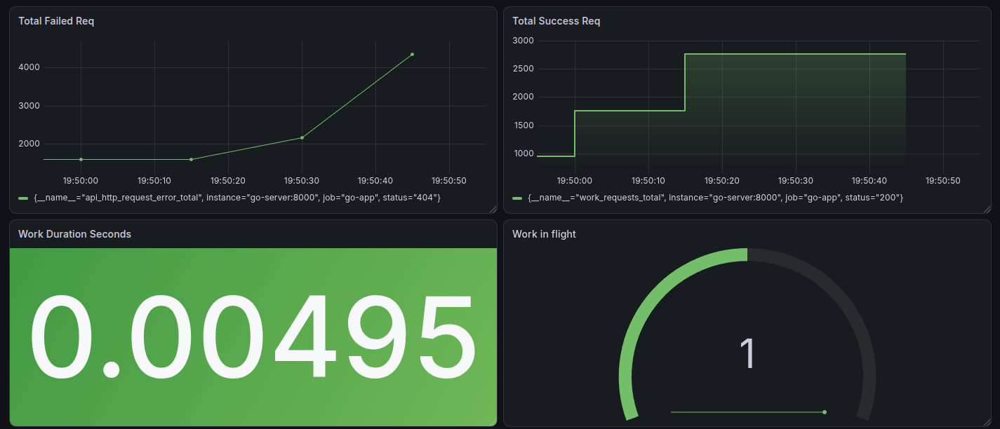
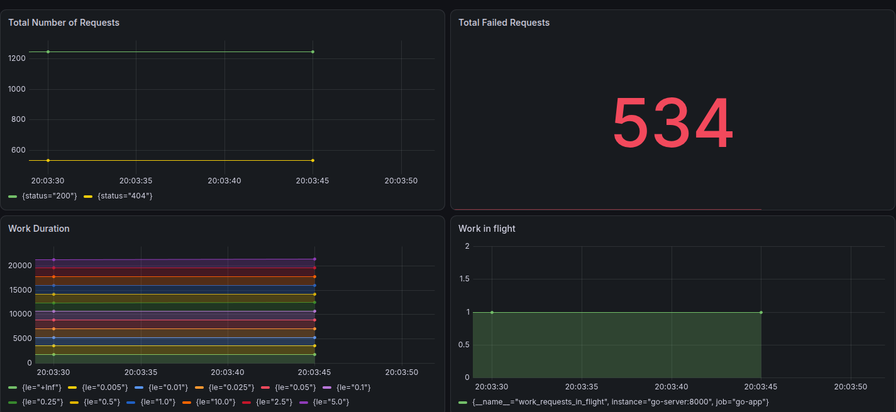
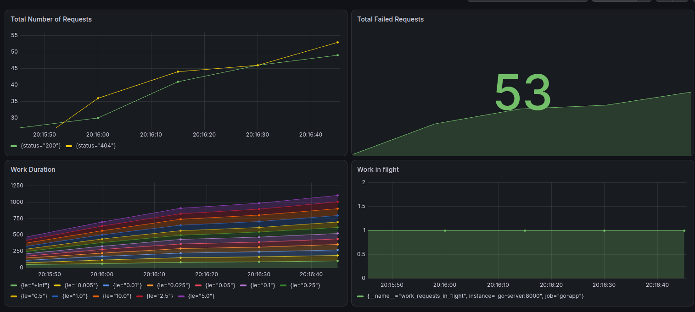
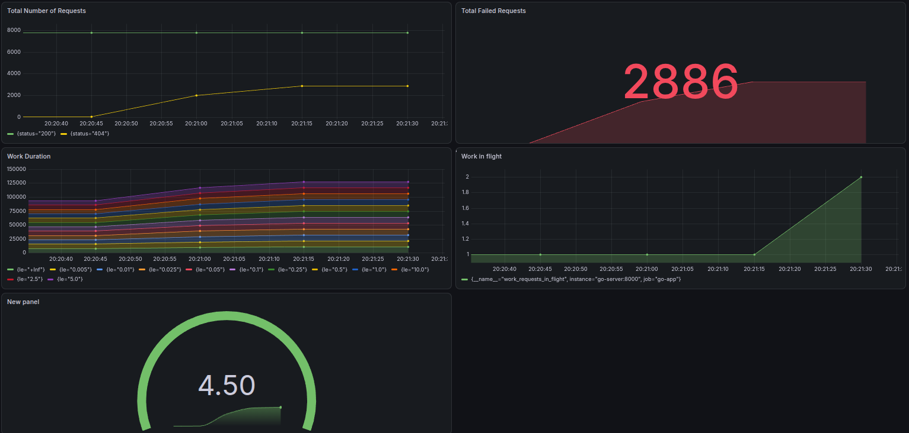
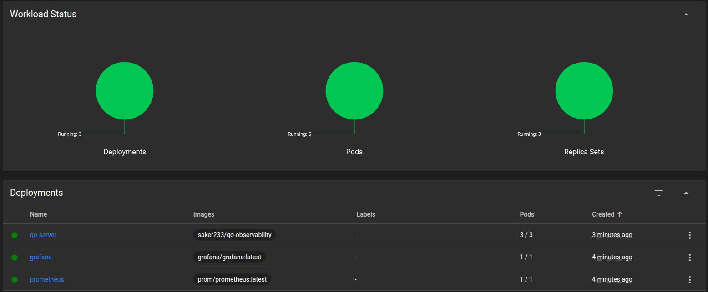

# Go Observability

A small Go HTTP service used to demonstrate application monitoring with
[Prometheus](https://prometheus.io/) and [Grafana](https://grafana.com/). The
project can be run as a single Docker container, as a Docker Compose stack, or
deployed to Kubernetes. It follows the progression from a containerized app, to
a locally orchestrated monitoring stack, to a multi-replica cluster deployment.

## What it contains

- **Go API** — a Gin server with health-check and simulated-work endpoints.
- **Prometheus instrumentation** — custom HTTP counters, latency histogram,
  in-flight gauge, and Go/process runtime metrics, exposed at `/metrics`.
- **Prometheus** — scrapes the API every five seconds.
- **Grafana** — provisions a Prometheus datasource and includes an observability
  dashboard.
- **Docker Compose** — runs the API, Prometheus, and Grafana together.
- **Kubernetes manifests** — deploy the API with three replicas, configure
  Prometheus pod discovery and RBAC, and run Grafana with persistent storage.

## Architecture

```text
Client ──HTTP──> Go API (:8000)
                    ├── /health
                    ├── /work
                    └── /metrics <── Prometheus (:9090)
                                         └── Grafana (:3000)
```

In Docker Compose, Prometheus reaches the API at `go-server:8000` using the
Compose service name. In Kubernetes, Prometheus discovers running `go-server`
pods on port `8000`; Grafana queries the in-cluster Prometheus service.

## API

| Method | Path | Behavior |
| --- | --- | --- |
| `GET` | `/health` | Returns HTTP 200 and `{"message":"Healthy"}`. |
| `GET` | `/work` | Waits for 500 ms to simulate work, then returns HTTP 200 and `{"status":"work done!"}`. |
| `GET` | `/metrics` | Exposes Prometheus metrics in the standard scrape format. |

Example requests:

```sh
curl http://localhost:8000/health
curl http://localhost:8000/work
curl http://localhost:8000/metrics
```

### Metrics

The application registers these custom metrics:

| Metric | Type | Meaning |
| --- | --- | --- |
| `work_requests_total{status}` | Counter | HTTP requests, labeled by response status. |
| `api_http_request_error_total{status}` | Counter | Requests that finish with an HTTP status of 400 or greater. |
| `work_duration_seconds` | Histogram | Request duration in seconds. |
| `work_requests_in_flight` | Gauge | Requests currently being handled. |

Go runtime and process metrics are also collected. The middleware currently
wraps **all** routes, so the custom request count, duration, and in-flight
metrics include `/health`, `/work`, and `/metrics` requests—not just `/work`.
Prometheus counters are cumulative totals; use PromQL functions such as
`rate(work_requests_total[5m])` when graphing a per-second rate.

## Requirements

- Go **1.26.0** or later for running the source directly.
- Docker with the Compose v2 plugin for the container and Compose workflows.
- For the Kubernetes workflow: `kubectl`, a running Kubernetes cluster, an
  accessible container image registry, and (if using the supplied Ingress) an
  NGINX Ingress controller. Minikube is one option.

## Run the Go service directly

From the project root:

```sh
go run ./cmd/api
```

The server reads `PORT` from `app.env` (default in this project: `8000`). The
local `app.env` file is ignored by Git; create it if needed, for example:

```dotenv
PORT=8000
```

Then visit `http://localhost:8000/health` or scrape
`http://localhost:8000/metrics`.

## Run as a Docker container

Build and run only the API:

```sh
docker build -f server.dockerfile -t go-observability:local .
docker run --rm --name go-observability \
  --env-file app.env \
  -p 8000:8000 \
  go-observability:local
```

The multi-stage Docker build compiles the Go binary in a Go builder image and
copies it into a smaller Alpine runtime image. The container listens on port
`8000`.

## Run the full stack with Docker Compose

From the project root:

```sh
docker compose up -d --build
```

Or use the Makefile shortcuts:

```sh
make up
make logs
make down
```

| Service | URL | Notes |
| --- | --- | --- |
| Go API | <http://localhost:8000> | `/health`, `/work`, and `/metrics` |
| Prometheus | <http://localhost:9090> | Scrapes `go-server:8000` every five seconds |
| Grafana | <http://localhost:3000> | Local demo login: `admin` / `admin` |

The Compose file stores Grafana data in the named `grafana-data` volume, which
is retained by `docker compose down`. Use `docker compose down -v` only if you
also intend to remove that stored Grafana data.

Compose mounts the Prometheus datasource configuration into Grafana. The
dashboard JSON is included in the repository and baked into the custom Grafana
image; the Compose service uses the upstream Grafana image, so import
`grafana/go-observability.json` through Grafana's dashboard UI if you want to
load that dashboard in the Compose environment.

## Deploy to Kubernetes

The manifests in `k8s/` target the `default` namespace. The API deployment
expects the image `saker233/go-observability:latest` and starts three replicas.
Prometheus and Grafana use in-cluster services; Prometheus discovers API pods
using Kubernetes service discovery.

### Build and publish the images

The supplied deployment manifests refer to images in the `saker233` Docker Hub
namespace. Publish the API image and the custom Grafana image before applying
the deployments (or update the image names in the manifests to your own
registry):

```sh
docker build -f server.dockerfile \
  -t saker233/go-observability:latest .
docker push saker233/go-observability:latest

docker build -f grafana/grafana.dockerfile \
  -t saker233/go-observability-grafana:latest .
docker push saker233/go-observability-grafana:latest
```

The GitHub Actions workflow also builds and pushes the API image on pushes to
`main`. It requires the repository secrets `DOCKER_USERNAME` and
`DOCKER_PASSWORD`; it does not build the custom Grafana image.

### Apply the manifests

The two RBAC files have different purposes: `rbac.yml` creates the Prometheus
service account and namespaced role, while `prometheus-rbac.yaml` grants the
service account cluster-wide pod discovery required by the supplied
Prometheus configuration. Apply both:

```sh
kubectl apply -f k8s/rbac.yml
kubectl apply -f k8s/prometheus-rbac.yaml
kubectl apply -f k8s/server-deployment.yml
kubectl apply -f k8s/prometheus.yml
kubectl apply -f k8s/grafana.yml
kubectl apply -f k8s/ingress.yml
```

Check rollout status:

```sh
kubectl get deployments,pods,services
kubectl rollout status deployment/go-server
kubectl rollout status deployment/prometheus
kubectl rollout status deployment/grafana
```

### Access the Kubernetes services

The supplied Ingress requires an NGINX Ingress controller and maps these
hostnames:

- `go-observability.test` → Go API
- `grafana.test` → Grafana

For a local Minikube cluster, enable the ingress addon and map both names to the
Minikube IP in your hosts file. Ensure the controller is ready before browsing
to the URLs:

```sh
minikube addons enable ingress
minikube ip
kubectl get pods -n ingress-nginx
```

Add the IP reported by `minikube ip` to `/etc/hosts` for both hostnames, then
open `http://go-observability.test/health` and `http://grafana.test`. The
Kubernetes Grafana manifest sets the demo credentials to `admin` /
`admin123`.

For example, if `minikube ip` reports `192.168.49.2`, the hosts-file entry is:

```text
192.168.49.2 go-observability.test grafana.test
```

Alternatively, access services without Ingress using `kubectl port-forward`:

```sh
kubectl port-forward service/go-server 8000:8000
kubectl port-forward service/prometheus 9090:9090
kubectl port-forward service/grafana 3000:3000
```

Run each port-forward command in its own terminal. Then use the same local URLs
listed in the Compose section. To remove the deployment, delete the applied
resources with `kubectl delete -f` using the same manifest paths.

> **Demo credentials:** the Compose and Kubernetes manifests use fixed
> administrator passwords for local demonstration. Change them before using
> these configurations in any shared or production environment.

## Grafana dashboard and screenshots

The dashboard source is [`grafana/go-observability.json`](grafana/go-observability.json).
The custom Grafana image copies it into Grafana's provisioned dashboard
directory and loads the provider from `grafana/dashboards.yml`. It includes
panels for request counts, failed requests, request duration, in-flight
requests, and process CPU time.

The screenshots below show example dashboard and Minikube views from the
project. Metric values and time ranges are sample captures and will differ
when you run the stack.

### Grafana examples









### Minikube example



## Repository layout

```text
.
├── cmd/api/                  # Gin server, routes, handlers, and metrics middleware
├── prometheus/
│   ├── prometheus.go         # Custom and runtime metric registration
│   └── prometheus.yml        # Prometheus scrape config for Docker Compose
├── grafana/
│   ├── grafana.dockerfile    # Custom Grafana image with dashboard provisioning
│   ├── grafana.yml           # Prometheus datasource provisioning
│   ├── dashboards.yml        # Dashboard file provider
│   └── go-observability.json # Dashboard definition
├── k8s/                      # API, Prometheus, Grafana, RBAC, and Ingress manifests
├── images/                   # Example Grafana and Minikube screenshots
├── app.env                   # Local API configuration (PORT)
├── go.mod, go.sum            # Go module and dependency checksums
├── server.dockerfile         # Multi-stage API image build
├── docker-compose.yml        # Local API + Prometheus + Grafana stack
├── Makefile                  # Compose shortcuts: up, down, logs
└── .github/workflows/        # Build and publish the API image on main
```

## Configuration notes

- `app.env` controls the API port for local and Compose runs. Kubernetes sets
  `PORT=8000` directly in the API deployment.
- `prometheus/prometheus.yml` is for Compose and scrapes the `go-server` service
  by name.
- `k8s/prometheus.yml` is a ConfigMap and uses Kubernetes pod discovery.
- `grafana/grafana.yml` provisions Prometheus as the default datasource for the
  custom Grafana image. The Kubernetes Grafana manifest provides its datasource
  separately through a ConfigMap.
- The Makefile `up`, `down`, and `logs` targets are wrappers around Docker
  Compose commands.
